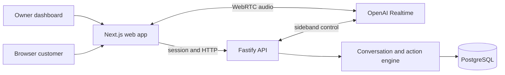

# Architecture and runtime boundaries

Status: Phases 1–2 implemented and locally verified. Conversation, builder and voice sections remain the later implementation plan and require their own authorization.

## System shape

Next.js provides owner and customer views. Fastify owns authentication, admission, configuration snapshots, conversation state and deterministic business actions. PostgreSQL is the system of record. Start with one API process, one web process and PostgreSQL. No queue, distributed cache or workflow engine is required.

## Trust boundaries

- Public sessions resolve tenant and published configuration server-side. Owner tests may select a draft revision; the server copies it into an immutable test snapshot before starting. A mutable draft is never a running session's configuration.
- The model interprets speech and produces conversation. It cannot establish tenant identity, grant permissions, attest ownership, approve its own proposal or directly commit a mutation.
- Business facts, FAQs and caller speech are untrusted content. They do not create tools or permissions. Private customer records are not loaded into general context.
- The browser is untrusted, including its data channel, playback acknowledgments and timer. Sideband control is not exclusive control of a directly connected client. All actions are independently checked in Fastify, and the server can terminate the provider call.
- Owner configuration routes require membership, role and CSRF checks. No configuration operation is exposed in the voice tool registry.

## Engine and model protocol

Persist the current block, state revision, latest input-turn ID, slots and their source turns, pending proposal ID, ownership handle, transition counters and outcome. The exact protocol is in [API.md](API.md); block transitions are in [BUILDER.md](BUILDER.md).

Use one server-owned turn controller. Disable automatic Realtime responses throughout the session. After a finalized input turn, an **interpretation response** is text-only with the sole function tool `submit_turn`. Its typed payload proposes intent, slot changes and an allowed read/preparation operation. The adapter attaches the input-turn ID and expected engine revision from the request it initiated; the model cannot choose those envelope values. The engine accepts or rejects the event, applies dependency invalidation and executes the permitted deterministic operation. A subsequent **speaking response** has no tools and receives only the approved stage directive and safe result. This uses the same Realtime session and audio input; no separate reasoning provider is required. It adds an inference step, so the early feasibility checkpoint must measure latency and cost.

Process a session's state transitions serially using a PostgreSQL row lock or revision compare-and-swap. Reject stale interpretation results and duplicate turn events. New speech cancels obsolete speaking/interpretation responses; late results cannot advance the engine. A request such as “Actually, Friday” invalidates a Thursday proposal before new availability is considered. Slot confidence is advisory, not a provider-guaranteed probability or an authorization signal.

## Confirmation and actions

Read and preparation operations are explicit contracts. Consequential writes are **engine-only operations**, not model-callable tools. A durable action proposal stores canonical fields, action identity, expiry and dependency revisions. The controller presents a complete read-back and binds the next confirmation to that proposal. For the initial English pilot, only a narrow exact affirmation grammar on finalized transcription is accepted automatically; corrections and mixed statements go back through interpretation. A scoped browser confirmation control is available when speech is uncertain. [VOICE.md](VOICE.md) defines the sequence and its limitations.

On confirmation the controller calls the mutation service directly. A transaction locks the proposal, verifies ownership and current revisions/policy, commits the record and receipt, and marks the proposal consumed. Only then is success speech requested. A new function-call ID cannot create another write from the same consumed proposal. A failed read-back, expired proposal or stale appointment requires a fresh read-back and confirmation. “Stop” received after a commit does not undo it; explain the recorded outcome and prepare a separate cancellation if requested.

## Scheduling and authority

All channels use the same action services, tenant context and database constraints. Availability is advisory until commit; PostgreSQL excludes overlapping confirmed appointments. Business hours, resource eligibility, service duration and scheduling policy are rechecked under the scheduling lock. Exact defaults, exception precedence and revision rules are in [DATABASE.md](DATABASE.md).

The pilot business must use this application as the authoritative schedule, including manually entering outside bookings, or reserve resources/time exclusively for it. The database cannot detect bookings held only in an external calendar. No calendar integration is implied.

## Session lifecycle

1. Validate consent, owner/public admission, budget reservation and selected configuration. Create one application session for one provider call. Owner preview works before first publication.
2. Browser submits SDP; Fastify creates a GA Realtime call with the permanent key kept server-side and attaches sideband. Begin with automatic responses disabled and no privileged tools. Do not enable conversation until control is ready.
3. Browser media flows directly to OpenAI. Fastify owns interpretation requests, engine events, action execution, finalized transcripts and usage accounting. UI receives application stage/receipt events.
4. On stop, idle limit, duration limit, control failure or budget limit, Fastify calls the provider hangup endpoint. Deny further mutations and retain the permit until termination is confirmed or reconciled. Browser cleanup is secondary.
5. MVP reconnect creates a new linked application session and a new provider call. Never replace the old provider call ID. Reconcile previous action receipts, invalidate unfinished proposals and require new confirmation and ownership verification. An authorized restart can reuse the previous immutable configuration; an independent new visit uses the latest published configuration.

The GA setup and control channels follow [OpenAI WebRTC](https://developers.openai.com/api/docs/guides/voice-webrtc) and [server controls](https://developers.openai.com/api/docs/guides/voice-server-controls). Shutdown uses [server hangup](https://developers.openai.com/api/reference/resources/realtime/subresources/calls/methods/hangup). Recheck provider compatibility at the later feasibility checkpoint.

## Preview, integration and failure behavior

Owner preview uses the real engine with an isolated synthetic action gateway and visibly simulated receipts; it does not prove database correctness. Zero-credit integration conversations instead use the real engine and business services against a disposable test database, with only model/transport events simulated. Real owner tests require explicit opt-in and produce tagged records in the real schedule.

Microphone denial, provider outage or declined transcription offers a provider-independent text inquiry form. A tool timeout does not imply a failed commit: resolve the durable proposal/receipt before announcing an outcome. Unknown status offers a status check/callback without a success claim. Unknown intents and exhausted clarification limits route to human assistance or public contact details. See [SECURITY.md](SECURITY.md), [VOICE.md](VOICE.md) and [TESTING.md](TESTING.md).

